# Ход выполнения работ

## БЛОК 1

### 1 часть
1. Создала на GitHub репозиторий `infra-project`.
2. Склонировала его в VS Code через терминал.
3. Создала файл `.gitignore` и вписала туда три строки.
4. Запушила изменения на GitHub.

### 2 часть
1. Распаковала zip-папку.
2. Перетащила нужные папки/файлы в `infra-project`.
3. По очереди сделала три коммита.

### 3 часть
1. Второй `git diff` ничего не показал, потому что с помощью команды `git add` мы уже добавили содержимое файла в индекс (staged).

---

## БЛОК 2

### 1 часть

Вывод команды `git log --oneline`:
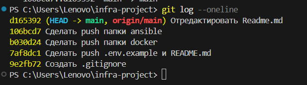

Вывод команды `git log --oneline --graph --all`:
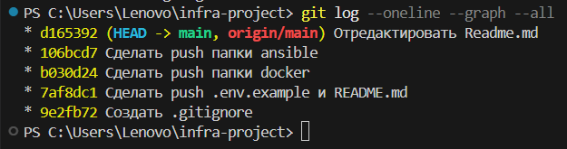

Вывод команды `git show HEAD~1`:
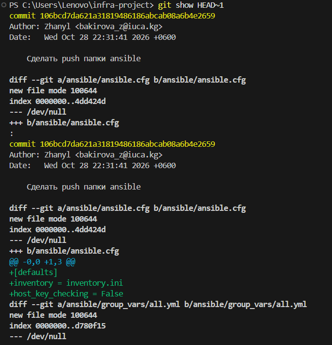

**Текстовый вывод терминала:**
```bash
PS C:\Users\Lenovo\infra-project> git log --oneline --graph --all
* d165392 (HEAD -> main, origin/main) Отредактировать Readme.md
* 106bcd7 Сделать push папки ansible
* b030d24 Сделать push папки docker
* 7af8dc1 Сделать push .env.example и README.md
* 9e2fb72 Создать .gitignore

PS C:\Users\Lenovo\infra-project> git show HEAD~1
commit 106bcd7da621a31819486186abcab08a6b4e2659
Author: Zhanyl <bakirova_z@iuca.kg>
Date:   Wed Oct 28 22:31:41 2026 +0600

    Сделать push папки ansible
```

## БЛОК 3

### 1 часть

Строка `HEALTHCHECK CMD wget -q0-http://localhost/ || exit 1`:
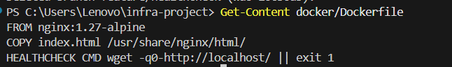

Вывод команды `git merge feature/healthcheck`:
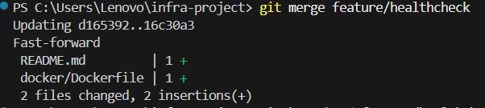

Вывод команды `git branch -d feature/healthcheck`:
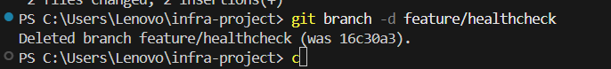

### 2 часть

Ошибка слияния (конфликт):
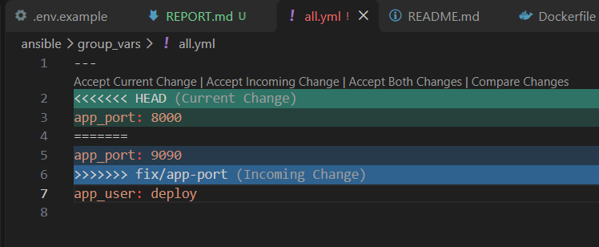

Вывод команды `git log --oneline --graph`:
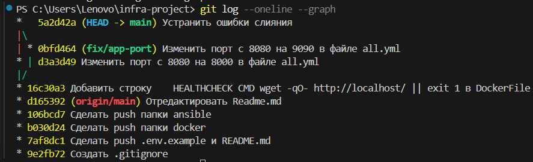

Вывод команд `git pull` и `git log --oneline`:
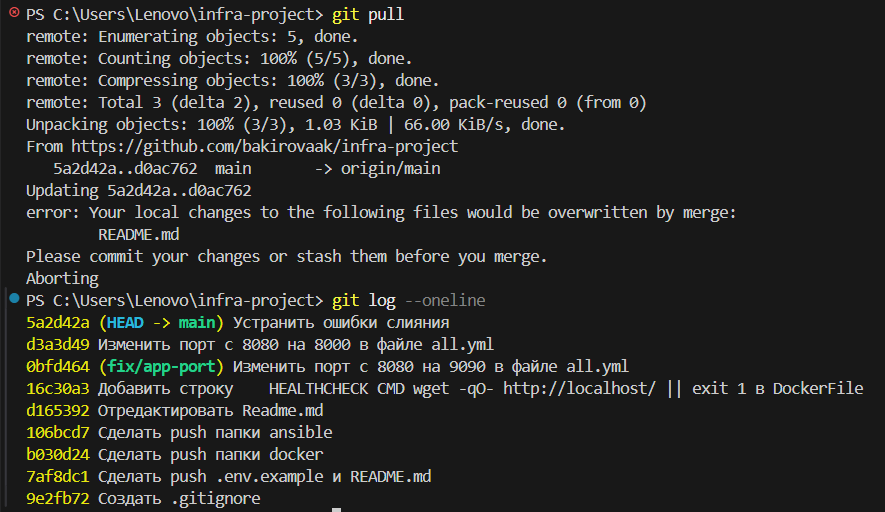


### 3 часть
Добавлена задача установки curl в playbook, чтобы утилита была доступна на серверах

Выводы команд git branch -a и git fetch --prune
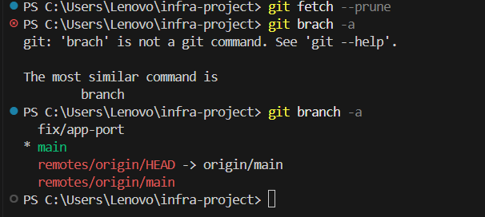


## БЛОК 4

### 1 часть

Страница на  localhost
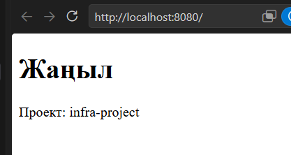


Удаление коммита
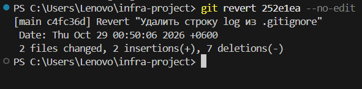

revert создаёт новый коммит, отменяющий старый, поэтому история остаётся целой и ничего не ломается у тех, кто уже скачал изменения


## Ответы на контрольные вопросы
1.Что такое коммит и зачем нужна область индекса (staging area)?

комит-это фиксирования состояния проекта здесь и сейчас чтоюы в дальнейшем отслеживать ход работы, а индексы дают возможность выбирать какие изменения пушить в гитхаб, а какие нет

2.Что такое ветка в Git?

это указатель на коммит который помогает вести разработку не мешая другим разработчикам

3.Что такое HEAD?

Head показывает на нынещний коммит или на ветку где мы находимся

4.Чем git fetch отличается от git pull?

первое только скачиват изменения, а второц скачивает и вливает изменения в текущую папку

5.Почему файл .env нельзя добавлять в репозиторий?
потому что там лежат пароли и токены, если сделать комит и запушить то они станут общедоступными и их могут видеть все кто заходит в репозиторий

На этом все
